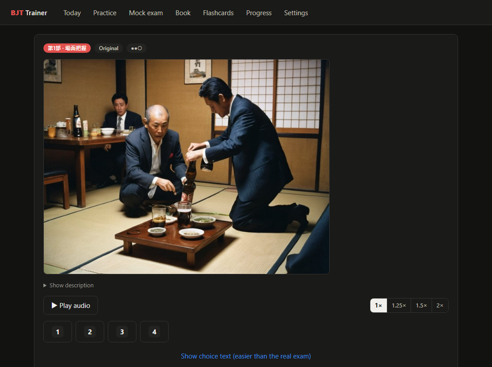
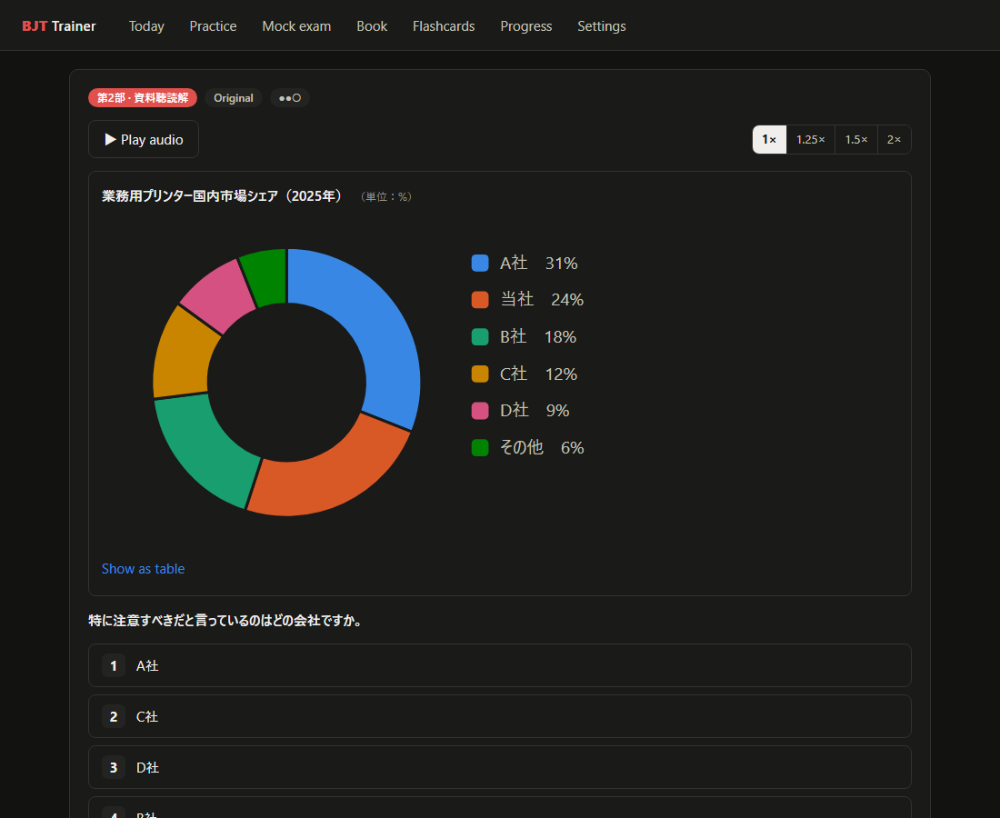
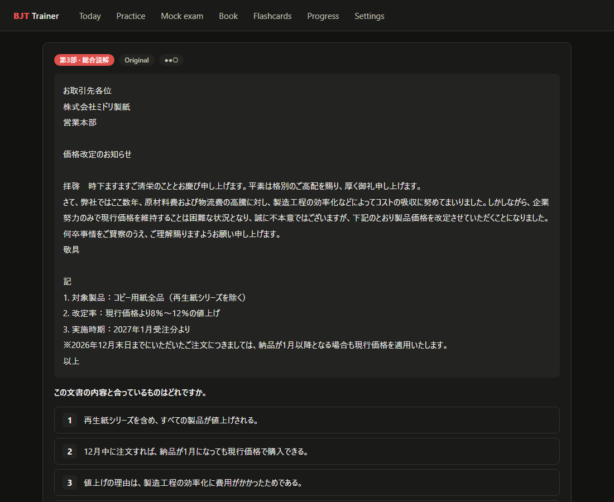
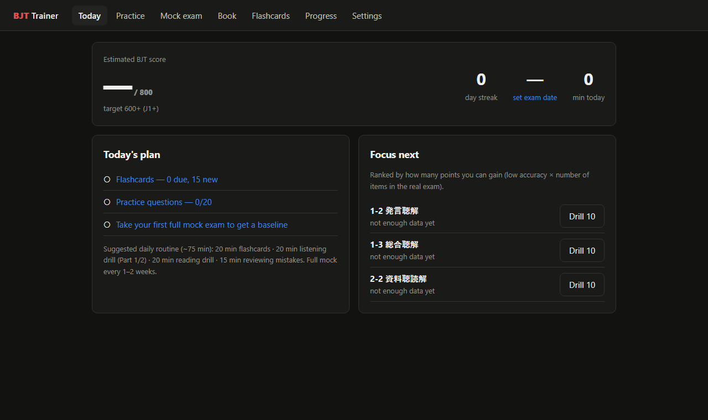
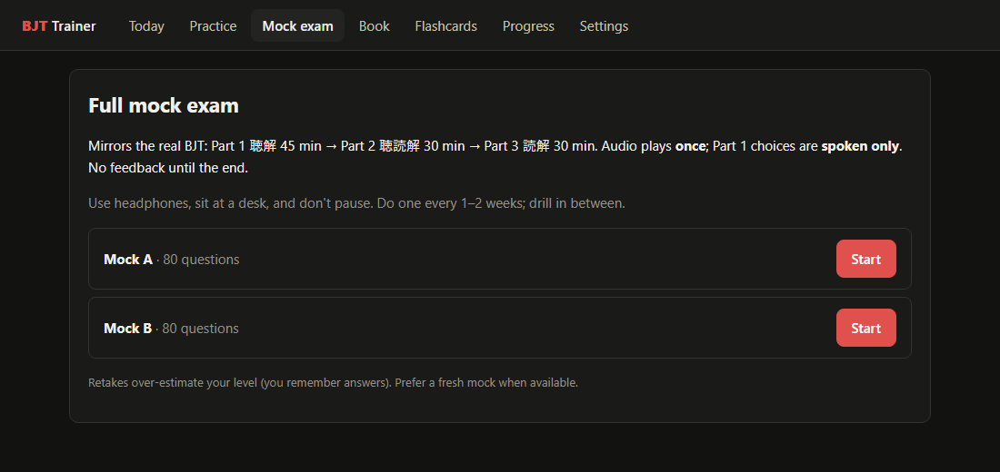
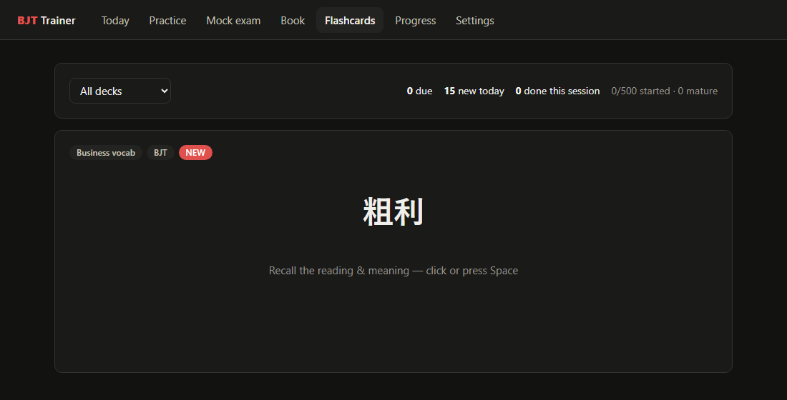
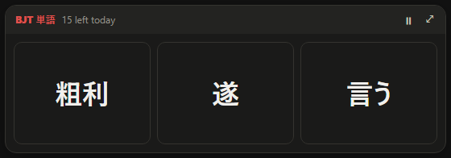

# BJT Trainer

A free study app for the **BJT ビジネス日本語能力テスト** (Business Japanese Proficiency Test). It has full mock exams in the real test format, natural-voice listening practice, spaced-repetition flashcards, and a small desktop widget that keeps showing you vocabulary throughout the day.

Built for going from **JLPT N2 to BJT 600+ (J1+)**, but useful at any level.



## Download and install (Windows 10/11)

1. Go to **[Releases → latest](https://github.com/Chamud/BJT/releases/latest)** and download **`BJT-Trainer-Setup-x.y.z.exe`**.
2. Double-click it. Windows will probably show **"Windows protected your PC"**, because the installer isn't code-signed (a certificate costs money). Click **More info → Run anyway**.
3. Choose where to install (the default is fine) and click **Install**. No administrator rights are needed.
4. BJT Trainer starts automatically. Look for the **漢 icon in the system tray** (next to the clock) and the **flashcard widget** in the bottom-right corner.

That's it. The app:
- **starts with Windows** (turn this off with tray right-click → Autostart),
- **updates itself** when a new version is published here,
- works **offline**, and keeps all your progress on your own PC.

**To uninstall:** Windows Settings → Apps → Installed apps → BJT Trainer → Uninstall.

## How to use it

| Where | What to do |
|---|---|
| **Flashcard widget** | Shows 3 words at a time, kanji only. Click a word to see its reading, meaning, example sentence and 🔊, then grade it Again / Hard / Good / Easy. A new set appears every 10 minutes. If you ignore a set, the widget pops up over your other windows 1 minute before it changes, as a reminder. Pause with ⏸. Open the full app with ⤢. |
| **Tray icon** | **Click:** bring up the widget. **Double-click:** open the full trainer. **Right-click:** Open · Hide/Show · Pause · Book folder · Autostart · Quit. |
| **Today** | Estimated score vs. your target, streak, today's plan, and the 3 sections where you can gain the most points |
| **Practice** | Drills by section, with instant feedback, audio, transcripts and explanations. Unseen and weak questions come first. |
| **Mock exam** | A full 80-question timed exam (Part 1 45 min, Part 2 30 min, Part 3 30 min). Audio plays once, as in the real test, and you see your results only at the end. |
| **Flashcards** | 500 cards: business vocabulary, N1 kanji, keigo, business set phrases and N1 grammar. Keys: Space flips the card, 1–4 grade it. |
| **Progress** | Score trend, accuracy by section, a study heatmap and mock history |
| **Settings** | Exam date, daily goals, speech speed, widget timing, quiet hours, and progress backup (Export/Import) |

**Listening speed:** every audio player has **1× / 1.25× / 1.5× / 2×** buttons. The real test plays at 1×. Practising at 1.25–1.5× makes 1× feel easy.

| | |
|---|---|
|  |  |
|  |  |
|  |  |

## What's included

- **Two original full mock exams (A and B)** plus a drill pack, written in the real BJT format:
  - Part 1 聴解 (listening): 5 / 10 / 10 questions
  - Part 2 聴読解 (listening and reading): 5 / 10 / 10
  - Part 3 読解 (reading): 10 / 10 / 10

  These are **new practice questions, not real past papers**.
- **The 24 official sample questions** from the BJT website. These use the official videos and images, linked from kanken.or.jp, plus an answer key.
- **Natural Japanese voices** (Microsoft neural voices Nanami and Keita) for every listening question and flashcard example.
- **Illustrations** for the Part 1 photo and picture questions, generated locally and checked one by one against each question's correct answer.

**About the score:** the real BJT scores answers with a statistical method (IRT) on a 0–800 scale, so the app's score is an **estimate** for tracking your trend, not a prediction.

## Optional: the official practice book

If you own **『BJTビジネス日本語能力テスト 公式模擬テスト&ガイド』** (Japan Kanji Aptitude Testing Foundation, ¥1,870), the **Book** tab can turn it into a timed mock exam. It shows your copy's pages, with an answer sheet, automatic grading, explanations and the book's real audio. The book isn't included here: you need your own copy.

1. Clone this repo and install Python 3 with `pip install pymupdf pillow`.
2. Create `content/private/book/answer_key.json` from the 正答一覧 page of your copy (the format is described in `tools/book_import.py`).
3. Run `python tools/book_import.py "path/to/your-book.pdf"`.
4. Download the book's audio from audiobook.jp using the serial code printed in your copy. Save it as `content/private/book/audio/book_full.mp3`, then run `python tools/book_audio_map.py`.
5. **Installed app:** tray → **Book folder**, then copy everything from `content/private/book/` into that folder and restart the app.

## Build from source (developers)

```
cd app && npm install && npm run dev          # web version at http://localhost:5180
cd desktop && npm install && npm run dist     # Windows installer in desktop/release/
```
- **Developer launcher:** double-click `BJT Trainer.vbs` (no console windows).
- **Adding questions or flashcards:** see [docs/ADDING_CONTENT.md](docs/ADDING_CONTENT.md) and [content/SCHEMA.md](content/SCHEMA.md), then run `node tools/validate.mjs`.
- **Neural audio for new packs:** run `python tools/render_audio.py` (questions) and `python tools/render_card_audio.py` (flashcards).

## Disclaimer

This is an independent, unofficial study tool. It is not affiliated with or endorsed by the Japan Kanji Aptitude Testing Foundation (日本漢字能力検定協会), which runs the BJT. "BJT" is used only to describe the test this app prepares for.
